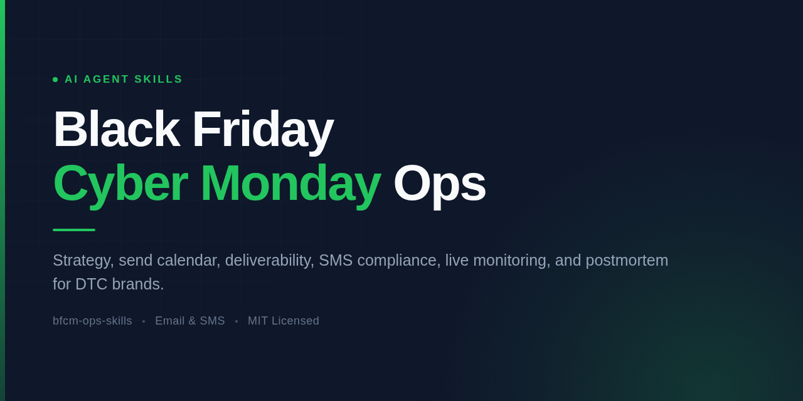

# BFCM Skills

Your BFCM operating system, inside the AI assistant you already use.

Most consumer brands plan Black Friday Cyber Monday across old campaign reports, spreadsheets, Slack threads, and last-minute checklists. A general AI assistant can generate ideas, but it does not know how to coordinate deliverability, audiences, offers, email, SMS, flows, creative swaps, live monitoring, and the postmortem unless it is given a structure to follow.

This pack supplies that structure.

## What it helps you do

- Build a complete BFCM strategy and preparation timeline.
- Turn the strategy into a dated email and SMS calendar.
- Protect deliverability while increasing sending volume.
- Plan VIP, repeat-buyer, engagement-tier, and exclusion logic.
- Coordinate site creative, popups, flows, campaigns, and SMS.
- Write campaign, popup, email, and SMS copy.
- Monitor live results and decide what to change.
- Revert sale-specific infrastructure safely after the event.
- Produce a 48–72-hour review and a 30-day customer-quality postmortem.

The skills provide expertise, decision frameworks, and deliverables. They do not log into Klaviyo, Shopify, or another platform on their own — that requires an approved connector in your AI environment.

## Included skills

| Skill | Use it for |
|---|---|
| `bfcm-strategy` | Broad BFCM planning, execution, monitoring, and review. The entry point. |
| `bfcm-schedule` | Turning an established strategy into a dated email and SMS calendar. |
| `bfcm-inbox` | Authentication, sender reputation, suppression, list hygiene, and volume ramping. |
| `bfcm-messaging` | Consent, quiet hours, frequency, timing, copy, and email/SMS coordination. |

## Start here

Once the pack is installed, ask:

> Help me build our complete BFCM campaign plan.

The strategy skill will collect what it needs — sale window, offer, current sending cadence, audience health, SMS setup, previous results, and existing discount logic.

You can also make focused requests:

- "Our sale starts November 20. Build our preparation timeline."
- "Turn this offer into a dated email and SMS calendar."
- "We currently send three emails per week. Build a safe BFCM volume ramp."
- "Audit our BFCM SMS plan for frequency and compliance risks."
- "Here are last year's results. Tell us what to repeat, stop, and test."

## Install in Claude

### Add the GitHub marketplace

In Claude or Claude Desktop:

This repository is not on the public marketplace directory yet, so add it as a repository source:

1. Open **Customize → Plugins**.
2. Select **Add → Add marketplace**.
3. Choose **Add from a repository**.
4. Enter `horaniai/bfcm-ops-skills`.
5. Add **BFCM Skills**.

In Claude Code:

```text
/plugin marketplace add horaniai/bfcm-ops-skills
/plugin install bfcm-ops-skills@bfcm-ops-skills
```

Claude skills documentation: https://support.claude.com/en/articles/12512180-use-skills-in-claude

## Install in ChatGPT or Codex

This repository follows the portable Agent Plugins layout used by ChatGPT and Codex. It is **not published to any plugin directory**, so clone the repository or point your environment at the `skills/` directories directly.

```text
https://github.com/horaniai/bfcm-ops-skills
```

OpenAI skills documentation: https://developers.openai.com/api/docs/guides/tools-skills

## Install in Muse Code

Clone the repository, then install the skills you want:

```bash
muse skills install ./skills/bfcm-strategy
muse skills install ./skills/bfcm-schedule
muse skills install ./skills/bfcm-inbox
muse skills install ./skills/bfcm-messaging
```

Muse Code skills documentation: https://meta-models.github.io/muse-code-sdk/next/guides/extend/skills/

## Install in OpenClaw

Clone the repository and copy the four directories under `skills/` into your OpenClaw workspace or shared skills directory. Review any third-party skill's contents before enabling it.

OpenClaw skills documentation: https://docs.openclaw.ai/skills

## Repository structure

```text
bfcm-ops-skills/
├── plugin.json
├── .claude-plugin/
│   ├── plugin.json
│   └── marketplace.json
└── skills/
    ├── bfcm-strategy/
    │   ├── SKILL.md
    │   ├── assets/
    │   │   └── bfcm-plan-builder.md
    │   └── references/
    │       ├── audience-tiers.md
    │       ├── campaign-sends.md
    │       ├── deliverability.md
    │       ├── forms-and-flows.md
    │       ├── monitoring-and-retention.md
    │       ├── season-dates.md
    │       └── sms-rules.md
    ├── bfcm-schedule/
    │   └── SKILL.md
    ├── bfcm-inbox/
    │   └── SKILL.md
    └── bfcm-messaging/
        └── SKILL.md
```

## License

MIT
